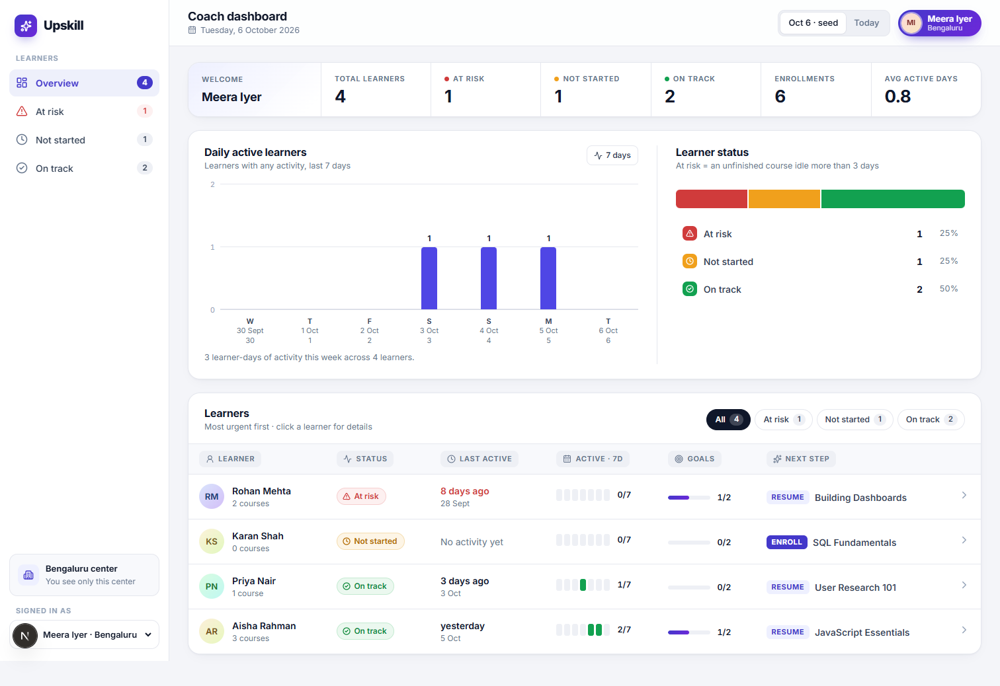
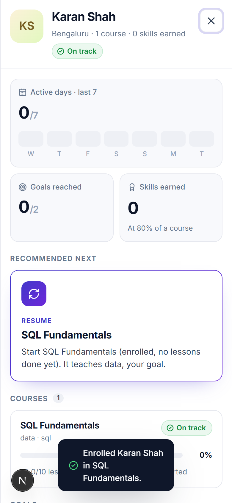
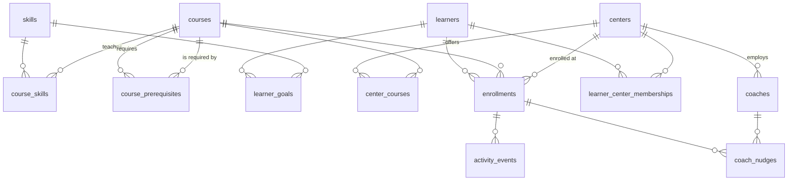

# Upskill: coach dashboard

A dashboard for one job: **a coach opens it and sees, in a few seconds, who is on track, who is at risk, and what each learner should do next.**





## Run it

Requires Node 20+.

```bash
npm install
npm run db:reset     # builds upskill.db from db/schema.sql + seed/*.json
npm run dev          # http://localhost:3000
npm test             # rule tests (vitest)
```

Optional: `npm run move-learner -- s3 ctr_pun` moves Priya to the Pune center. Switch the coach to Arjun to see her there with her progress intact.

**Stack:** Next.js (App Router, route handlers), TypeScript, SQLite through libSQL. It runs locally from a file and can deploy to Vercel with a Turso database by setting `DATABASE_URL` / `DATABASE_AUTH_TOKEN`. No ORM; the schema is plain SQL in [`db/schema.sql`](db/schema.sql). UI: plain CSS (light/dark), Inter font, lucide icons.

### Deploy

Live: **https://upskill-learning-dashboard.vercel.app**

If the database has no tables, the app seeds it on first request (`lib/db.ts`), so a fresh deploy needs no manual step.

- **As deployed (no env vars):** SQLite in the serverless function's `/tmp`. It works for a demo, but each server instance has its own copy and a cold start re-seeds it. An enrollment can therefore disappear after a while, which also resets the demo.
- **Persistent:** create a free [Turso](https://turso.tech) database and set `DATABASE_URL` (`libsql://…`) and `DATABASE_AUTH_TOKEN` in Vercel. No code change; the same libSQL client talks to it, and it seeds itself on first request.

## What's in the app

| Brief | Where |
|---|---|
| Student picker: goals, earned skills, active days (last 7) | The learners table is the picker: click a row to open the learner in a slide-over panel with goals, earned skills and a 7-day activity strip. On a phone the rows become cards and the panel goes full screen. |
| My courses: % complete, on-track / at-risk | Course cards with a progress bar and status. Completed courses get their own status, so a course finished a month ago is not "at risk". |
| Recommend next: one course with a reason | "Recommended next" card. See the [algorithm](#recommend-next). |
| Enroll, UI updates | Button on the recommendation. The server re-checks eligibility and returns the updated learner; the table, stat strip, charts, courses and recommendation all update without a reload. |
| ≥3 students, empty / loading / error, phone | 5 learners. Skeleton while loading. Error card with retry. Empty states for no learners, goals, skills, courses or recommendation. Tested at 390px wide with no horizontal scroll. |

### The "As of" switch: why it exists

The seed's newest activity is **Oct 5, 2026**. Measured against the real clock, every learner is at risk with 0 active days, which hides the logic you want to see. The header has **As of: Oct 6 (seed) | Today**. The seed clock (`2026-10-06 12:00 IST`) is the default. It is used for reads *and* writes (enrollments and nudges are stamped with it), so the demo stays consistent. In production this switch would not exist.

## Rules, and how ambiguous cases are decided

All rules are pure functions in [`lib/rules.ts`](lib/rules.ts), covered by [`tests/rules.test.ts`](tests/rules.test.ts).

| Rule | Decision |
|---|---|
| Skill earned | Course that teaches it is **≥ 80%** complete. Integer math (`done*100 >= total*80`) avoids float edge cases. |
| Prerequisite "complete" | **100%**. The brief uses "complete" here and "at least 80%" for skills, so I read them as different thresholds. Aisha shows why it matters: JS Essentials at 83% earns `javascript`, but does **not** unlock React Basics. |
| Eligible | Not already enrolled, offered at the learner's center, all prerequisites at 100%. |
| At-risk | Unfinished course with **more than 3** calendar days since last activity. Exactly 3 is on track (Priya in the seed sits on this boundary). Completed courses are never at risk. |
| Days | Calendar days in the **center's timezone** (`centers.timezone`), not 24-hour blocks and not UTC. Activity at 23:30 IST counts for that IST day. |
| Never-started course | Counts from its enrollment date, so a new enrollment is on track and turns at-risk if nobody starts it. |
| Active days | Distinct calendar days with any activity in the 7 days ending on "as of" (today included). |
| Percent | Rounded down, so 99.9% never shows as 100%. |
| Seed inconsistency | Aisha is enrolled in React Basics while its prerequisite is at 83%. The data is kept as it is; the course card shows "Started before finishing JavaScript Essentials". New enrollments can't do this. |

### Recommend next

One step, in this order:

1. **Enroll** in an eligible course that teaches an unmet goal (most goals covered first, then the shorter course).
2. **Enroll** in an eligible course that is a prerequisite on the path to a goal course ("First step toward React Basics…").
3. **Resume** an unfinished enrolled course on a goal path. Prefer one the learner can work on now, then one that blocks a goal course, then the furthest along. The reason mentions inactivity if it's at risk.
4. **None**, with the honest reason (no goals, all goals met, or nothing at this center helps).

Steps 3 and 4 matter more than they look: in the seed, **all three students are already enrolled in their goal course**, so a recommender that only suggests new enrollments has nothing to say. With the fallback the output becomes:

- Aisha: *Finish JavaScript Essentials (83% done). It unlocks React Basics, which teaches react.*
- Rohan: *Keep going with Building Dashboards (25% done)… No activity for 8 days.*
- Karan (added, no courses): *Enroll: SQL Fundamentals. Teaches data, your goal.*
- Neha (added, Pune): *Enroll: Web Foundations. First step toward React Basics.*

## Schema

Normalized SQLite. The JSON in `seed/` is only an import format: `db/seed.ts` loads it once and the app reads tables only. Nothing derived is stored. Percent, earned skills, status, active days and eligibility are computed from the facts below.



| Table | Key | Columns / constraints | Scope |
|---|---|---|---|
| `skills` | `id` (slug) | `name` unique | Shared |
| `courses` | `id` | `title`, `total_lessons > 0` | Shared |
| `course_skills` | (`course_id`, `skill_id`) | FKs to courses, skills | Shared |
| `course_prerequisites` | (`course_id`, `prerequisite_id`) | both FK → courses; no self-reference | Shared |
| `learners` | `id` | `name` | Shared (a person, not a center's record) |
| `learner_goals` | (`learner_id`, `skill_id`) | | Shared, follows the learner |
| `centers` | `id` | `name` unique, `timezone` | The tenant |
| `center_courses` | (`center_id`, `course_id`) | which shared courses a center offers | Per center |
| `coaches` | `id` | `center_id` FK, not null | Per center |
| `learner_center_memberships` | `id` | `learner_id`, `center_id`, `started_at`, `ended_at`; partial unique index: **one open membership per learner** | Links the two |
| `enrollments` | `id` | `learner_id`, `course_id`, `center_id` (where it happened), `enrolled_at`, `completed_lessons ≥ 0`; **unique (`learner_id`, `course_id`)**; triggers block `completed_lessons > total_lessons` | Follows the learner |
| `activity_events` | `id` | `enrollment_id`, `occurred_at`; index (`enrollment_id`, `occurred_at`) | Follows the learner |
| `coach_nudges` | `id` | `coach_id`, `enrollment_id`, `created_at` | Per center (through the coach) |

Notes on modelling choices:

- **`totalLessons` moved to `courses`.** In the seed it sits on each progress row, but it describes the course. The seed script fails if two rows disagree.
- **`progress` became `enrollments.completed_lessons` + `activity_events`.** The seed's `lastActiveAt` becomes one event; "last active" is `MAX(occurred_at)`. One timestamp can't answer "active days in the last 7", so a stored `last_active_at` column would have been both redundant and not enough.
- **Timestamps are stored as UTC ISO-8601** so string order equals time order. Day boundaries are applied at read time using the center's timezone.
- **Not modelled:** individual lessons (a counter is enough for these rules) and coaches spanning several centers (a `coach_centers` join table would replace `coaches.center_id`).

### Multi-center

**Shared:** the catalog (`courses`, `skills`, `course_skills`, `course_prerequisites`) and the person (`learners`, `learner_goals`), plus their learning record (`enrollments`, `activity_events`).
**Per center:** `centers`, `coaches`, `center_courses` (what each center offers), `learner_center_memberships`, and `coach_nudges` through the coach.

- **A coach sees only their center.** Every learner query goes through one function, `loadLearnersInCenter(centerId)` in `lib/queries.ts`. It joins the learner's *open* membership to the coach's `center_id`. Writes (enroll, nudge) load the learner through the same function, so a Pune coach asking for a Bengaluru learner gets a 404. Today the coach is picked from a dropdown; in production `coachId` comes from the session, never from the client. With Postgres, I'd also add row-level security on `center_id` as a second check.
- **A learner can move.** Moving closes the open membership row and opens a new one in one transaction (`moveLearner`, `npm run move-learner`). Goals, enrollments, progress and earned skills belong to the learner, so they come along; the new coach sees them at once and the old coach stops seeing the learner. History is kept. `enrollments.center_id` still records where each course was taken, for per-center reporting.
- **Catalog shared, offering per center.** A center can stop offering a course without forking the catalog. Eligibility checks `center_courses`.
- **Timezone per center.** "Inactive for more than 3 days" means local days.

The seed adds two centers (Bengaluru with Meera, Pune with Arjun) and two learners (`seed/extra.json`, clearly marked). No courses were added.

## Add-ons

1. **Triage table, most urgent first.** The student picker is also the coach's to-do list. At-risk learners come first (longest idle first), then learners who haven't started, then on-track, then completed. Each row shows status, last active, a 7-day activity strip, goal progress and the next step. The stat strip, sidebar and filter chips count at-risk / not started / on-track, and clicking any of them filters the table. Two small charts give the center view: daily active learners over the last 7 days (hover shows who), and the status split. This is the core of "who needs me today".
2. **Goal progress.** Goals show as earned (✓) or pending, with "1 / 2 goals reached". Courses are the means; goals are what learners and coaches care about.
3. **Nudge log.** At-risk courses have **Log nudge**. It records that the coach reached out about that course, and the card shows "Nudged 6 Oct". This stops two coaches (or one coach on two days) from nudging the same person, and it is the data you'd later use to see whether nudges work. It doesn't send anything; coaches already have chat.

### Chosen not to build

- **Course catalog / browsing / search.** Out of scope by the brief. Enrolling happens through the recommendation, which already applies the rules.
- **Auth.** The coach dropdown stands in for login. Isolation is enforced on the server, so adding a session later only changes where `coachId` comes from.
- **Sending messages / emails.** The nudge log records contact; it doesn't become a messaging product.
- **Learner-side progress editing, gamification and streaks.** These don't help a coach decide who needs help.
- **Multi-tenant admin UI.** Moving a learner is a script; the schema supports it.
- **Pagination.** Fine for a center of dozens; the dashboard endpoint would need it for hundreds.

## API

| Method | Path | Notes |
|---|---|---|
| GET | `/api/coaches` | Coach list (stands in for "who am I") |
| GET | `/api/dashboard?coachId=&clock=seed\|today` | Every learner in the coach's center, computed, in triage order |
| POST | `/api/enrollments` `{coachId, learnerId, courseId, clock}` | 400 bad input · 404 learner not in your center / unknown course · 409 already enrolled · 422 not eligible / not offered. Returns the updated learner. |
| POST | `/api/nudges` `{coachId, learnerId, enrollmentId, clock}` | Returns the updated learner |

## Tests

`npm test` runs 23 tests on the rules: the 80% skill boundary, at-risk at exactly 3 vs 4 days, timezone day boundaries, active-day counting, 100% prerequisites, eligibility rejections, every recommendation branch against the real seed, and triage order. The API paths (eligibility rejection, cross-center access, duplicate enroll, bad body) and the UI flow (phone layout, enroll, error state) were checked by hand against a running build.

## How I used Claude

<!-- Sandhya: edit this section so it is accurate to how you worked. -->

I used Claude Code (Claude Opus 5.5) as a pair programmer:

- **Understanding the brief:** went through the brief and seed data together, working out each rule by hand per student. This surfaced the edge cases above: the 3-day boundary, the 80% vs 100% question, the stale seed date, and that every seed student is already enrolled in their goal course.
- **Code:** Claude wrote most of the first draft of the schema, seed script, rules, API and UI from the decisions I made. I reviewed, ran and adjusted it.
- **Tests:** Claude drafted the rule tests from the cases we worked out by hand.
- **Checking:** used Claude to drive headless Chrome for the phone-width check and screenshots.

The product decisions are mine: what counts as complete, the "as of" clock, the recommendation fallback, which add-ons to build and what to leave out.
